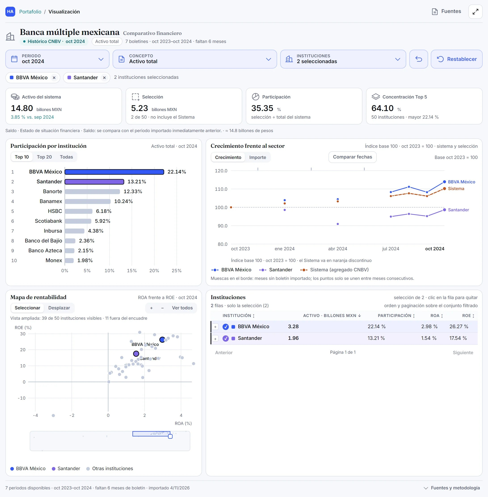

# Banca múltiple mexicana · Comparativo financiero

Explora la participación, el crecimiento y la rentabilidad de los bancos en
México con cifras publicadas por la **CNBV**: ranking por institución, evolución
temporal, dispersión ROA–ROE y tabla de detalle, todo con un mismo estado de
filtros.

[](https://github.com/Dev-HugoAguilar/mexican-banking-analytics/actions/workflows/tests.yml)
[](app)
[](#datos-y-atribución)

> **Alcance.** Aplicación de lectura del boletín estadístico. No es un sistema de
> riesgo ni un modelo de solvencia: compara cifras publicadas y declara sus
> unidades.

---

## Ejecutar

Requiere la API del portafolio (`portfolio-api`) en el puerto 8010:

```bash
python -m uvicorn app.main:app --port 8010   # terminal 1

cd app && npm ci && npm run dev              # terminal 2
```

Producción: `npm run build`. La suite de navegador del proyecto usa Playwright
(`app/tests/`).



## Qué demuestra

- **Un sector comparable sin trampas**: la columna «Sistema» es el agregado
  publicado y **nunca** se suma con las instituciones.
- **Flujos contra su propia base**: los importes acumulados solo se comparan con
  el mismo corte del año anterior.
- **Huecos, no interpolaciones**: los meses sin boletín se marcan como faltantes.
- **Consistencia de estado**: 66 pruebas de navegador verifican que ranking,
  serie, dispersión y tabla responden a la misma selección, en escritorio y móvil.

## Datos y atribución

**CNBV**, Boletín Estadístico de Banca Múltiple (sector 40 del Portafolio de
Información): 7 boletines importados, **56 248 hechos**, **158 conceptos**,
**50 instituciones** y 7 periodos disponibles (oct 2023 – oct 2024), conciliados
celda por celda contra los archivos originales sin discrepancias.

## Estructura

```text
app/                 Aplicación React + TypeScript (Vite)
  src/               Estado, consultas, tablas y visualizaciones D3
  tests/             Pruebas de navegador con Playwright
  tools/             Minificador y utilidades de build
docs/LEEME.md        Documentación original del proyecto
docs/cover.jpg       Captura real de la aplicación
```

## Límites

- Solo banca múltiple: no incluye banca de desarrollo, sofomes ni otras entidades.
- Los conceptos acumulados no son comparables con saldos puntuales.
- La cobertura temporal depende de los boletines publicados (7 periodos).
- Las cifras son nominales y no están ajustadas por inflación.

## Seguridad y contribución

Sin credenciales ni datos personales en el repositorio. Ver [`SECURITY.md`](SECURITY.md)
y [`CONTRIBUTING.md`](CONTRIBUTING.md).
